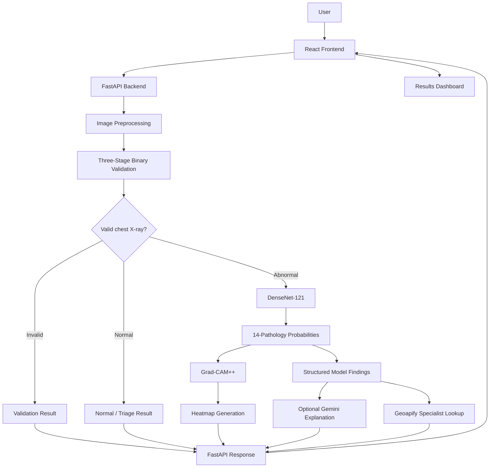
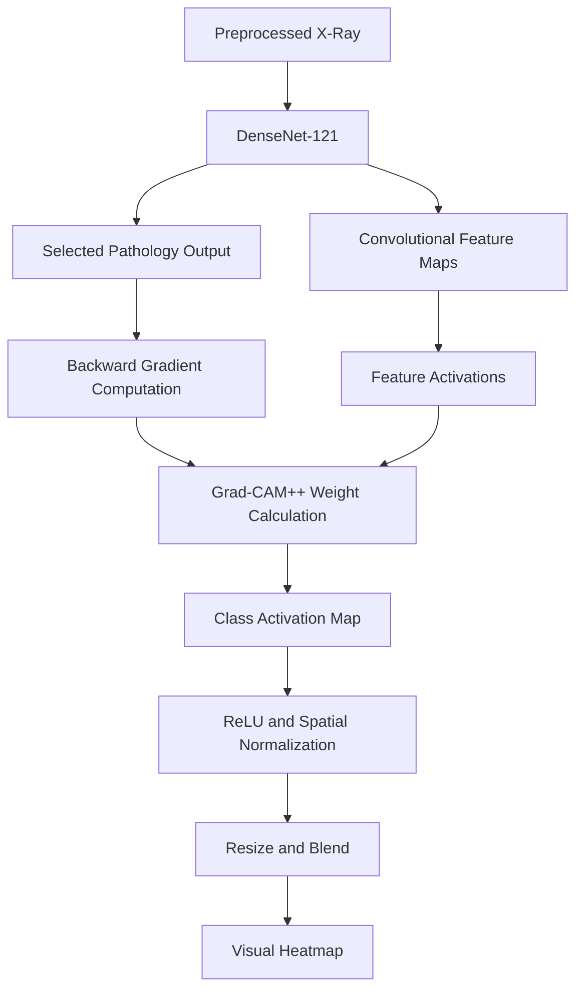
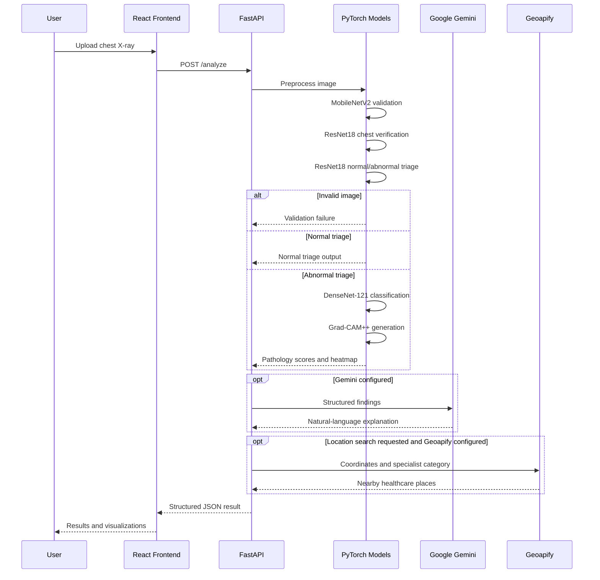

 <div align="center">


<h2>Chest X-Ray Diagnostic Assistant</h2>

<h3>Multi-Stage Deep Learning with Explainability for Thoracic Pathology Analysis</h3>

<p>
  <a href="https://github.com/Nitish-Konamarthi/Chest-X-Ray-Diagnostic-Assistant">
    
  </a>
  <a href="https://chest-x-ray-diagnostic-assistant.vercel.app">
    
  </a>
  <a href="https://pypi.org/project/chest-xray-diagnosis/">
    
  </a>
  <a href="https://www.npmjs.com/package/chest-xray-diagnosis">
    
  </a>
  <a href="https://ijirt.org/publishedpaper/IJIRT198365_PAPER.pdf">
    
  </a>
</p>

<p>
  <b>PyTorch</b> · <b>DenseNet-121</b> · <b>ResNet-18</b> · <b>MobileNetV2</b> · <b>Grad-CAM++</b> · <b>FastAPI</b> · <b>React</b>
</p>

<p><i>An end-to-end research and software engineering project combining medical image classification, model interpretability, AI-assisted explanations and developer-oriented package distribution.</i></p>

</div>

---

## 1. Project Overview

**Chest X-Ray Diagnostic Assistant** is an explainable AI research application developed to explore automated thoracic pathology classification through a sequential deep-learning pipeline.

The system combines image validation, multi-label classification, model interpretability and application-level integrations in one workflow.

Rather than applying a computationally intensive pathology classifier directly to every uploaded image, the system first performs a sequence of validation and triage operations.

For eligible chest X-ray inputs, a DenseNet-121 model produces probability scores for 14 thoracic conditions. Grad-CAM++ generates visualizations of image regions that contributed to selected model predictions.

The structured model output can then be passed to an optional Google Gemini integration for natural-language explanations. A separate Geoapify integration supports location-based specialist discovery.

The project is available in several forms:

- A React and FastAPI web application.
- A Python package published on PyPI.
- A Node.js launcher published on npm.
- A published academic research paper.
- A publicly accessible application deployment.

### Core engineering objectives

1. Build a sequential image validation pipeline to reject irrelevant or unsuitable inputs.
2. Apply transfer learning to multi-label chest X-ray classification.
3. Generate interpretable visualizations of model predictions.
4. Convert structured model outputs into more understandable explanatory text.
5. Integrate optional location-based specialist discovery.
6. Package the software for reusable developer workflows.
7. Provide a reproducible technical reference for the research and implementation.

> **Medical disclaimer:** This project is intended strictly for research and educational purposes. It is not a clinically validated diagnostic device, does not replace radiologist interpretation and must not be used for diagnosis or treatment decisions.

---

## 2. Quick Links and Published Work

| Resource | Link |
|---|---|
| GitHub repository | [Source code](https://github.com/Nitish-Konamarthi/Chest-X-Ray-Diagnostic-Assistant) |
| Web application | [Open application](https://chest-x-ray-diagnostic-assistant.vercel.app) |
| Python package | [PyPI: chest-xray-diagnosis](https://pypi.org/project/chest-xray-diagnosis/) |
| Node.js package | [npm: chest-xray-diagnosis](https://www.npmjs.com/package/chest-xray-diagnosis) |
| GitHub release | [v1.0.1](https://github.com/Nitish-Konamarthi/Chest-X-Ray-Diagnostic-Assistant/releases/tag/v1.0.1) |
| Research paper | [IJIRT 198365 — PDF](https://ijirt.org/publishedpaper/IJIRT198365_PAPER.pdf) |
| Technical assessment guide | [ML and Deep Learning Guide](ML_DEEP_LEARNING_ASSESSMENT_GUIDE.md) |
| Model evaluation output | [results.txt](results.txt) |

---

## 3. System Architecture

The application is organized around a React frontend, a FastAPI backend, a collection of PyTorch models and optional external services.

### High-level architecture



### Component responsibilities

| Component | Responsibility | Technology |
|---|---|---|
| Web interface | Image upload, processing status and results display | React |
| API backend | Request handling, inference orchestration and response generation | FastAPI |
| Image preprocessing | Resize, convert and normalize model inputs | Pillow, TorchVision |
| Input validation | Filter irrelevant images and verify chest anatomy | MobileNetV2, ResNet18 |
| Preliminary triage | Normal/abnormal classification | ResNet18 |
| Main classifier | Multi-label pathology classification | DenseNet-121 |
| Explainability | Gradient-based feature-map visualization | Grad-CAM++ |
| Natural-language explanation | Structured findings explanation | Google Gemini |
| Specialist discovery | Location-based healthcare place search | Geoapify |

---

## 4. The Multi-Stage Inference Pipeline

The central design decision is to separate inexpensive input validation and preliminary triage from the main multi-label classification stage.

The binary pipeline consists of three classifiers, followed by the main DenseNet-121 analysis where applicable.

### Stage 1 — Image validity: MobileNetV2

**Question: Is the uploaded image an X-ray or unrelated content?**

The first model is a MobileNetV2-based binary classifier.

Its purpose is to distinguish X-ray images from unrelated or invalid image inputs.

MobileNetV2 is used for this initial screening task because it offers a relatively lightweight convolutional architecture.

**Input:** Preprocessed image.

**Output:** Validity classification and confidence.

Invalid inputs are rejected before progressing through the remaining image analysis stages.

### Stage 2 — Chest anatomy verification: ResNet18

**Question: Is the X-ray specifically a chest radiograph?**

A separately trained ResNet18 classifier distinguishes chest X-rays from other X-ray images.

This additional validation step helps ensure that the pathology classifier receives the intended image type.

**Input:** An image that passes Stage 1.

**Output:** Chest-versus-other classification.

### Stage 3 — Normal versus abnormal triage: ResNet18

**Question: Does the image appear normal or abnormal according to the triage model?**

A second ResNet18-based binary classifier performs preliminary normal-versus-abnormal classification.

The implementation follows a conditional inference strategy:

- Normal classification: the main DenseNet pathology stage can be skipped.
- Abnormal classification: continue to the multi-label pathology classifier.

This allows the application to avoid unnecessary execution of the main pathology model for inputs classified as normal by the preliminary triage model.

The preliminary classification is not a clinical clearance or proof that an image is disease-free.

### Stage 4 — Multi-label pathology classification: DenseNet-121

**Question: Which of the supported thoracic pathology labels receive elevated model probabilities?**

Images passing the validation stages and proceeding to the abnormal pathway are analyzed using DenseNet-121.

The model uses a classification head with 14 sigmoid outputs, allowing each pathology to receive an independent probability score.

Unlike single-class classification, multi-label classification allows more than one pathology to be represented in the same image.

The system uses condition-specific thresholds to convert model probabilities into application-level findings.

### Supported pathology labels

| # | Pathology |
|---:|---|
| 1 | Atelectasis |
| 2 | Cardiomegaly |
| 3 | Effusion |
| 4 | Infiltration |
| 5 | Mass |
| 6 | Nodule |
| 7 | Pneumonia |
| 8 | Pneumothorax |
| 9 | Consolidation |
| 10 | Edema |
| 11 | Emphysema |
| 12 | Fibrosis |
| 13 | Pleural Thickening |
| 14 | Hernia |

**Model output:** Per-pathology probabilities, confidence categories and threshold-based application decisions.

A threshold-based decision is an application output, not a clinically validated diagnosis.

---

## 5. Model Architecture and Deep Learning

### DenseNet-121

DenseNet-121 is the primary multi-label classifier in this project.

DenseNet uses dense connectivity between layers, where later layers receive feature information from preceding layers within a dense block.

This architecture encourages feature reuse and improves information and gradient propagation through the network.

The implementation:

- Initializes the DenseNet-121 backbone.
- Replaces the original classification layer with a 14-output classifier.
- Applies sigmoid activation to each output.
- Produces independent pathology probability estimates.

Conceptually:

```text
Input Chest X-Ray
       |
       v
Image Preprocessing
       |
       v
DenseNet-121 Feature Extractor
       |
       v
Global Feature Representation
       |
       v
14-Unit Classification Head
       |
       v
Sigmoid Activation
       |
       v
14 Independent Pathology Scores
```

### Binary validation models

| Model | Architecture | Classification task |
|---|---|---|
| Model 1 | MobileNetV2 | X-ray versus non-X-ray |
| Model 2 | ResNet18 | Chest versus other X-ray |
| Model 3 | ResNet18 | Normal versus abnormal |

The ResNet18 implementations use transfer learning, with task-specific classification heads.

### Transfer learning

Transfer learning is used to adapt pretrained image representations to the medical imaging tasks.

Instead of learning all visual representations from randomly initialized parameters, pretrained feature extractors provide an initial representation that can be adapted to the target image classification problem.

The research methodology discusses staged fine-tuning of the binary classifiers.

### Image preprocessing

The research methodology describes a standardized preprocessing pipeline based on:

- Resizing images to 224 × 224.
- Conversion to three-channel image tensors.
- Floating-point tensor conversion.
- Channel-wise normalization using ImageNet statistics.

The preprocessing is intended to standardize image inputs before inference.

The exact preprocessing and checkpoint configuration must remain consistent between training, evaluation and inference.

---

## 6. Research Dataset and Evaluation

### NIH ChestX-ray14

The main multi-label classification research uses the NIH ChestX-ray14 dataset, also referred to as CXR8 in the publication.

The dataset contains:

| Dataset property | Published information |
|---|---:|
| Total images | 112,120 |
| Patients | 30,805 |
| Pathology labels | 14 |
| Task | Multi-label classification |

The dataset provides multiple pathology labels per image and includes train, validation and test splits.

The research also documents an internal 80/20 stratified split of training data with a fixed random seed of 42.

**Important dataset consideration:** The NIH dataset labels were derived from radiology reports using natural-language processing. This can introduce label noise and should be considered when interpreting model results.

The dataset is not included in this repository. Obtain it from its original source and comply with its applicable access and usage terms.

### Published evaluation result

<div align="center">

<h2>0.8779</h2>

**Mean AUROC — 14-pathology DenseNet-121 evaluation**

<sub>Reported in IJIRT 198365, April 2026</sub>

</div>

The published paper reports the following per-pathology AUROC values at the selected checkpoint.

| Pathology | Reported AUROC |
|---|---:|
| Atelectasis | 0.8333 |
| Cardiomegaly | 0.9434 |
| Effusion | 0.7848 |
| Infiltration | 0.9050 |
| Mass | 0.8628 |
| Nodule | 0.9614 |
| Pneumonia | 0.9138 |
| Pneumothorax | 0.9857 |
| Consolidation | 0.7665 |
| Edema | 0.9005 |
| Emphysema | 0.8514 |
| Fibrosis | 0.8507 |
| Pleural Thickening | 0.7936 |
| Hernia | 0.9383 |
| **Mean AUROC** | **0.8779** |

These are the research results reported in the publication, not independently reproduced or clinically validated performance metrics.

The paper reports a best DenseNet-121 validation checkpoint at epoch 12 with an overall validation AUROC of approximately 0.8780.

### Interpreting AUROC

AUROC measures how well a model ranks positive examples above negative examples across decision thresholds.

It does not, by itself, establish:

- Clinical sensitivity at a particular operating threshold.
- Clinical specificity.
- Calibration of predicted probabilities.
- Positive or negative predictive value in a real patient population.
- Generalization to hospitals and imaging equipment not represented in training.

Some pathology categories show stronger reported discrimination than others. Consolidation and effusion, for example, have lower reported AUROC values than pneumothorax and nodule.

This is important when interpreting multi-label model outputs.

**Evaluation output:** [`results.txt`](results.txt)

**Full research methodology and results:** [IJIRT publication](https://ijirt.org/publishedpaper/IJIRT198365_PAPER.pdf)

---

## 7. Explainable AI — Grad-CAM++

Classification scores indicate what the model predicts, but they do not directly show which spatial features contributed to a prediction.

This project integrates Grad-CAM++ to generate visual explanations from the DenseNet-121 feature representations and gradients.

### How it works

1. Run a forward pass through DenseNet-121.
2. Identify the selected classification output.
3. Capture feature maps from the final convolutional feature layer.
4. Compute gradients of the selected output with respect to the feature activations.
5. Calculate Grad-CAM++ importance weights.
6. Generate a spatial activation map.
7. Resize and blend the map with the original X-ray image.

### Explainability workflow



The implementation is maintained in:

[`backend/src/HeatmapGenerator.py`](backend/src/HeatmapGenerator.py)

### Why Grad-CAM++?

Grad-CAM++ uses gradient-based weighting to produce class-specific localization visualizations.

These maps can help developers and researchers inspect whether model activations are concentrated around potentially relevant image regions.

**Interpretability limitation:** A heatmap is not proof of anatomical localization, a causal explanation, or evidence that a pathology is present. It is a visualization of model behaviour and should be interpreted accordingly.

---

## 8. AI-Assisted Natural-Language Explanations

The application includes an optional Google Gemini integration.

The model output consists of structured information such as:

- Normal/abnormal triage result.
- Pathology labels.
- Model probabilities.
- Confidence categories.
- Threshold-based findings.

The explainability module constructs prompts using these structured outputs and requests a natural-language explanation.

The application is designed to produce sections covering:

- Summary.
- Model findings.
- Symptoms and monitoring information.
- General precautions.
- Recommended next steps.

### Optional API integration

The Gemini integration is not required for local model inference.

When the Gemini dependency or API key is unavailable, the application includes a rule-based fallback explanation path.

This separation allows the core machine-learning inference stage to function independently of the external language model service.

**Important boundary:** Gemini generates explanatory language from application-provided findings. It is not the pathology classifier, does not independently validate the prediction and must not be treated as a medical authority.

---

## 9. Location-Based Specialist Discovery — Geoapify

The application also includes an optional Geoapify Places integration.

The specialist finder uses:

1. Structured pathology output.
2. A pathology-to-specialist mapping.
3. User-provided geographic coordinates.
4. Geoapify Places API queries.
5. Returned clinic or healthcare-place information.

Examples of the configured mapping include:

| Finding category | Suggested specialist category |
|---|---|
| Pneumonia / Effusion | Pulmonology |
| Cardiomegaly / Edema | Cardiology |
| Mass / Nodule | Oncology |
| Hernia | General surgery |

The integration supports a general healthcare-provider fallback when a specialist-specific result is unavailable.

### Privacy and external service boundaries

The core image model inference is performed locally by the Python backend.

The Gemini integration sends structured explanatory inputs to an external Google service when enabled.

The Geoapify integration sends location and search information to an external places service when enabled.

Therefore, the application should not be described as entirely offline or as guaranteeing that all information remains local.

Avoid submitting identifiable patient information to external services.

---

## 10. Full Application Workflow

The following sequence brings the individual components together.



---

## 11. Frontend Architecture

The frontend is implemented with React 18 and component-based JavaScript.

Its primary responsibility is to provide an interface for submitting an image and displaying the backend's structured response.

### Main components

| Component | Responsibility |
|---|---|
| `App.js` | Application state and analysis orchestration |
| `Header.js` | Application navigation and identity |
| `UploadSection.js` | Image selection and upload |
| `BinaryPipelineStatus.js` | Validation-stage status |
| `ImagePanel.js` | Original image and heatmap display |
| `PathologyResults.js` | Multi-label results and confidence display |
| `AIExplanationCard.js` | Natural-language explanation display |
| `NearbyDoctors.js` | Specialist discovery results |

### User experience flow

1. Select and upload a chest X-ray.
2. Submit the image for analysis.
3. Follow the image validation status.
4. View the appropriate normal or abnormal analysis result.
5. Inspect pathology probabilities and heatmap output where generated.
6. Read the optional explanation.
7. Access the separate specialist discovery results where available.

The frontend does not execute the machine-learning models; it communicates with the FastAPI backend.

---

## 12. Backend Architecture

The backend is implemented using Python and FastAPI.

The backend coordinates request processing, model loading, inference, explainability, response construction and optional external integrations.

### Main modules

| Module | Responsibility |
|---|---|
| `backend/app.py` | API initialization, routing, model orchestration and response schemas |
| `backend/src/binary_pipeline.py` | Three-stage image validation and triage |
| `backend/src/DensenetModels.py` | DenseNet architecture definitions |
| `backend/src/HeatmapGenerator.py` | Grad-CAM++ heatmap generation |
| `backend/src/explainability_ai.py` | Gemini explanation and fallback logic |
| `backend/src/geoapify_service.py` | Specialist discovery integration |

### API endpoints

| Method | Endpoint | Purpose |
|---|---|---|
| POST | `/analyze` | Upload an image for analysis |
| POST | `/find-doctors` | Search for healthcare providers using coordinates and pathology information |
| GET | `/health` | Backend health check |

### Example analysis response

```json
{
  "binary_pipeline": [
    {
      "model": "Image Validation",
      "is_valid": true,
      "confidence": 0.98,
      "message": "Valid chest X-ray"
    }
  ],
  "valid_for_analysis": true,
  "is_normal": false,
  "clinical_summary": "Research model findings available",
  "assessment_level": "ABNORMAL",
  "pathologies": [
    {
      "pathology": "Pneumonia",
      "probability": 0.82,
      "confidence_level": "HIGH",
      "clinical_decision": "POSITIVE"
    }
  ],
  "heatmap_b64": "data:image/png;base64,...",
  "ai_explanation": "Structured explanatory text...",
  "processing_time_ms": 250.0
}
```

This is an illustrative response schema, not a recorded patient result or a clinical finding.

---

## 13. Repository Structure

```text
Chest-X-Ray-Diagnostic-Assistant/
│
├── backend/
│   ├── app.py
│   ├── requirements.txt
│   ├── Dockerfile
│   ├── download_models.py
│   │
│   ├── models/
│   │   ├── chexnet/
│   │   └── binary/
│   │
│   └── src/
│       ├── binary_pipeline.py
│       ├── DensenetModels.py
│       ├── HeatmapGenerator.py
│       ├── explainability_ai.py
│       └── geoapify_service.py
│
├── frontend/
│   ├── public/
│   ├── src/
│   │   ├── App.js
│   │   ├── App.css
│   │   └── components/
│   │       ├── Header.js
│   │       ├── UploadSection.js
│   │       ├── BinaryPipelineStatus.js
│   │       ├── ImagePanel.js
│   │       ├── PathologyResults.js
│   │       ├── AIExplanationCard.js
│   │       └── NearbyDoctors.js
│   ├── package.json
│   └── vercel.json
│
├── docs/
│
├── scripts/
│
├── chexnet
│
├── data_organizer.py
├── dataset_organizer.py
├── organize_images.py
├── results.txt
├── test_integration.py
├── ML_DEEP_LEARNING_ASSESSMENT_GUIDE.md
├── IJIRT Reseach paper-K Nitish V Venkatesh.docx
├── Certificate.jpeg
└── README.md
```

The binary model checkpoints and the main DenseNet-121 checkpoint are downloaded or supplied separately by the model setup process; they are not all visible as ordinary source files in the repository.

---

## 14. Published Python Package — PyPI

The core application was also packaged as a reusable Python distribution.

<div align="center">

<a href="https://pypi.org/project/chest-xray-diagnosis/">
  
</a>
<a href="https://img.shields.io/pypi/l/chest-xray-diagnosis">
  
</a>

</div>

**Package:** `chest-xray-diagnosis`

**Published version:** `1.0.1`

**Maintainer:** NitishKvv

**Licence:** MIT

**Python requirement:** 3.9 or later

### Install

```bash
pip install chest-xray-diagnosis
```

### CLI commands

Configure optional external integrations:

```bash
chest-xray-diagnosis setup
```

Download model weights:

```bash
chest-xray-diagnosis download-models
```

Analyze an image:

```bash
chest-xray-diagnosis analyze path/to/chest_xray.png
```

Start the API:

```bash
chest-xray-diagnosis serve --port 8000
```

The server exposes interactive API documentation through:

```text
http://localhost:8000/docs
```

### Python SDK usage

```python
from chexray_diagnosis import ChestXRayAnalyzer

analyzer = ChestXRayAnalyzer(
    gemini_api_key="YOUR_GEMINI_API_KEY",
    geoapify_api_key="YOUR_GEOAPIFY_API_KEY"
)

result = analyzer.analyze("chest_xray.png")

print(result["is_normal"])
print(result["clinical_summary"])
print(result["pathologies"])
print(result["ai_explanation"])
print(result["heatmap_b64"])
```

The Gemini and Geoapify keys are optional. The local model pipeline can be used independently of these external services.

**Package documentation:** [PyPI project page](https://pypi.org/project/chest-xray-diagnosis/)

---

## 15. Published Node.js Package — npm

A Node.js distribution was also published to make the Python inference backend accessible through a familiar JavaScript package workflow.

<div align="center">

<a href="https://www.npmjs.com/package/chest-xray-diagnosis">
  
</a>
<a href="https://img.shields.io/npm/l/chest-xray-diagnosis">
  
</a>

</div>

**Package:** `chest-xray-diagnosis`

**Published version:** `1.0.1`

**Publisher:** `konamarthi-nitish-veera-venkatesh`

**Licence:** MIT

### Run through npx

```bash
npx chest-xray-diagnosis serve --port 8000
```

### How the Node.js package works

The npm package is a Node.js launcher around the Python application, rather than a separate JavaScript implementation of the machine-learning models.

The package workflow is designed to:

1. Check for a supported Python installation.
2. Create an isolated Python virtual environment.
3. Install the backend's Python dependencies.
4. Download model weights through the model setup process.
5. Launch the FastAPI inference server.

This provides an entry point for Node.js developers without requiring them to manually assemble the backend environment.

The Python inference implementation remains the source of the machine-learning functionality.

**Package:** [npm — chest-xray-diagnosis](https://www.npmjs.com/package/chest-xray-diagnosis)

**Publisher profile:** [npm publisher](https://www.npmjs.com/~konamarthi-nitish-veera-venkatesh)

---

## 16. Deployment

### Public web application

The React frontend is deployed through Vercel.

**Live application:**

[https://chest-x-ray-diagnostic-assistant.vercel.app](https://chest-x-ray-diagnostic-assistant.vercel.app)

The frontend uses a Vercel configuration with Create React App build output and frontend routing rewrites.

### Backend deployment configuration

The repository contains a Dockerfile intended for deployment to Hugging Face Spaces using the Docker SDK.

The container configuration includes:

- Python 3.10 base image.
- CPU-oriented PyTorch installation.
- FastAPI and Uvicorn.
- OpenCV and image-processing dependencies.
- Model downloading during image build.
- Runtime environment configuration.
- FastAPI server on port 7860.

The backend deployment configuration and public frontend deployment are separate components.

### Deployment architecture

```text
Browser
   |
   v
Vercel
React Frontend
   |
   | HTTPS API Requests
   v
FastAPI Backend
   |
   +---- PyTorch Models
   |
   +---- Grad-CAM++
   |
   +---- Optional Gemini API
   |
   +---- Optional Geoapify API
```

The Dockerfile describes a separate backend deployment configuration. Its presence alone should not be interpreted as proof that the backend is currently running or production-ready.

---

## 17. Research Publication — IJIRT

This implementation is associated with a published academic research paper.

<div align="center">

<a href="https://ijirt.org/publishedpaper/IJIRT198365_PAPER.pdf">
  
</a>

</div>

### Paper title

**Multi-Stage Deep Learning with Explainability for Chest X-Ray Pathology Detection using DenseNet-121**

| Publication detail | Information |
|---|---|
| Journal | International Journal of Innovative Research in Technology (IJIRT) |
| Publication month | April 2026 |
| Volume | 12 |
| Issue | 11 |
| Paper ID | IJIRT 198365 |
| ISSN | 2349-6002 |
| Research area | Medical imaging, deep learning and explainable AI |

### Published authorship

The paper lists the following authors:

1. Mrs. T. Kranthi
2. K. Nitish V Venkatesh
3. Marrapu Tarun
4. Karanam Swapna Preethi
5. Gorli Praveena
6. Shaik Mohammed Marshuk

The publication identifies Mrs. T. Kranthi as an Assistant Professor and the remaining listed authors as CSE department contributors.

### Research contribution

The research presents a layered chest X-ray analysis architecture incorporating:

- MobileNetV2-based non-X-ray input screening.
- ResNet18-based chest anatomy verification.
- ResNet18-based normal/abnormal triage.
- DenseNet-121 multi-label classification using NIH ChestX-ray14.
- Grad-CAM++ model interpretability.
- Google Gemini-based natural-language report synthesis.
- Geoapify-powered specialist discovery.

The paper reports an average DenseNet-121 AUROC of **0.8779** across 14 pathology classes.

### Research paper

[Download the full paper — IJIRT 198365 (PDF)](https://ijirt.org/publishedpaper/IJIRT198365_PAPER.pdf)

The publication is also included in the repository:

[Research document in the repository](https://github.com/Nitish-Konamarthi/Chest-X-Ray-Diagnostic-Assistant/blob/main/IJIRT%20Reseach%20paper-K%20Nitish%20V%20Venkatesh.docx)

---

## 18. GitHub Release History

The project has a published GitHub release:

### v1.0.1 — May 2026

[View GitHub release v1.0.1](https://github.com/Nitish-Konamarthi/Chest-X-Ray-Diagnostic-Assistant/releases/tag/v1.0.1)

The release focuses on packaging clarity, project organization, usability and distribution across Python and Node.js environments.

It announces the availability of the project through PyPI and npm.

This release establishes a traceable software distribution milestone alongside the research publication.

---

## 19. Running the Web Application Locally

### Prerequisites

- Python 3.9 or later.
- Node.js.
- npm.
- A compatible CPU or CUDA-enabled GPU.
- Optional Gemini API key.
- Optional Geoapify API key.

### Clone the repository

```bash
git clone https://github.com/Nitish-Konamarthi/Chest-X-Ray-Diagnostic-Assistant.git

cd Chest-X-Ray-Diagnostic-Assistant
```

### Configure the backend

```bash
cd backend

python -m venv .venv
```

Activate the environment.

**Windows PowerShell:**

```powershell
.venv\Scripts\Activate.ps1
```

**Linux / macOS:**

```bash
source .venv/bin/activate
```

Install dependencies:

```bash
pip install -r requirements.txt
```

Configure the environment variables in the project root `.env` file:

```env
GEMINI_API_KEY=your_gemini_api_key
GEOAPIFY_API_KEY=your_geoapify_api_key
ALLOWED_ORIGINS=http://localhost:3000
```

The external API keys are optional for the local inference pipeline.

Ensure that the required model checkpoints are available through the repository's documented model download process before running inference.

Start the backend:

```bash
uvicorn app:app --reload --host 0.0.0.0 --port 8000
```

The backend health endpoint is:

```text
http://localhost:8000/health
```

### Configure the frontend

Open a second terminal:

```bash
cd frontend

npm install
```

Start React:

```bash
npm start
```

Open:

```text
http://localhost:3000
```

The frontend must be configured to communicate with the FastAPI backend. Ensure that the backend CORS configuration permits the frontend origin.

---

## 20. Testing and Verification

The repository includes an integration-oriented test script:

[`test_integration.py`](test_integration.py)

It checks:

- Model and module imports.
- Expected model checkpoint paths.
- Backend application imports.
- Model integration dependencies.
- Environment configuration availability.

Run it from the repository root:

```bash
python test_integration.py
```

The project also contains a technical assessment guide:

[`ML_DEEP_LEARNING_ASSESSMENT_GUIDE.md`](ML_DEEP_LEARNING_ASSESSMENT_GUIDE.md)

This guide covers topics such as:

- CNN fundamentals.
- DenseNet architecture.
- ResNet and MobileNet.
- Transfer learning.
- Grad-CAM++.
- Loss functions and evaluation metrics.
- Training methodology.
- Model architecture and inference.

The integration script is a setup/import-oriented check, not a substitute for full model regression testing, clinical validation or reproducible evaluation.

---

## 21. Security, Privacy and Limitations

### Local inference

The core PyTorch image classification and heatmap generation stages execute in the backend application.

However, external integrations have separate data boundaries.

- Gemini receives structured findings when its explanation service is enabled.
- Geoapify receives location and search information when specialist discovery is used.
- Model weights may be downloaded from their configured distribution source.

### Security considerations

- Never commit API credentials or `.env` files.
- Configure restrictive CORS origins for deployments.
- Use HTTPS for deployed frontend/backend communication.
- Avoid uploading identifiable medical records to external services.
- Use only model weights and datasets in accordance with their applicable licences and usage requirements.

### Research limitations

This project has important limitations:

1. The reported evaluation uses the NIH ChestX-ray14 research dataset and does not establish performance across all hospitals and patient populations.
2. Dataset labels generated from radiology reports can contain noise.
3. AUROC does not establish clinical sensitivity, specificity, calibration or predictive value at a particular operating threshold.
4. Model thresholds require additional independent validation before clinical interpretation.
5. Grad-CAM++ is a model visualization method, not a clinical localization guarantee.
6. Language-model explanations can introduce errors and must not be treated as verified medical conclusions.
7. Specialist discovery results are third-party place-search results and are not endorsements or clinical referrals.

**This application is not approved or validated for clinical use.** All outputs should be treated as research-oriented model outputs, not medical advice or diagnosis.

---

## 22. Future Research and Engineering Directions

Potential future work includes:

- External validation on independent chest radiography cohorts.
- Patient-level evaluation and stronger data-split verification.
- Calibration analysis and threshold validation.
- Sensitivity, specificity, precision, recall and F1-score reporting at defined operating points.
- Improved dataset documentation and reproducibility.
- Additional explainability comparisons.
- Better inference benchmarking across CPU and GPU hardware.
- API integration testing and model-loading regression tests.
- Package compatibility testing across supported Python and Node.js environments.
- More complete deployment and operational documentation.

These are proposed improvements, not claims about existing functionality.

---

## 23. Acknowledgements and References

### Dataset

- [NIH ChestX-ray14 Dataset](https://nihcc.app.box.com/v/ChestXray-Nihil)
- [NIH Clinical Center](https://www.cc.nih.gov/)

### Research methods and technologies

- DenseNet: [Densely Connected Convolutional Networks](https://arxiv.org/abs/1608.06993)
- ResNet: [Deep Residual Learning for Image Recognition](https://arxiv.org/abs/1512.03385)
- MobileNetV2: [Inverted Residuals and Linear Bottlenecks](https://arxiv.org/abs/1801.04381)
- Grad-CAM: [Visual Explanations from Deep Networks](https://arxiv.org/abs/1610.02391)
- Grad-CAM++: [Improved Visual Explanations for Deep CNNs](https://arxiv.org/abs/1710.11063)

### Frameworks and services

- [PyTorch](https://pytorch.org/)
- [TorchVision](https://pytorch.org/vision/stable/index.html)
- [FastAPI](https://fastapi.tiangolo.com/)
- [React](https://react.dev/)
- [Google Gemini API](https://ai.google.dev/)
- [Geoapify Places API](https://apidocs.geoapify.com/docs/places/)

---

## 24. Maintainer and Project Credits

**Project repository:** [Chest-X-Ray-Diagnostic-Assistant](https://github.com/Nitish-Konamarthi/Chest-X-Ray-Diagnostic-Assistant)

**Maintainer:** Konamarthi Nitish Veera Venkatesh

**GitHub:** [Nitish-Konamarthi](https://github.com/Nitish-Konamarthi)

**Published software:**

- [PyPI package](https://pypi.org/project/chest-xray-diagnosis/)
- [npm package](https://www.npmjs.com/package/chest-xray-diagnosis)

**Research:** [IJIRT 198365](https://ijirt.org/publishedpaper/IJIRT198365_PAPER.pdf)

<div align="center">


<b>Applied Deep Learning. Explainable Models. Reproducible Research.</b>

<p><sub>Developed for research and educational exploration of AI in medical imaging.</sub></p>

</div>
